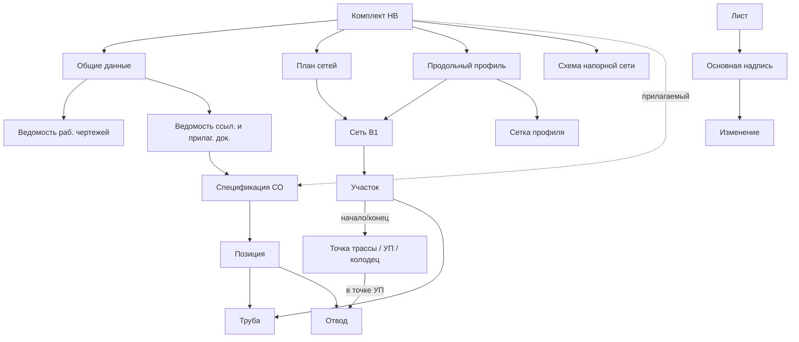

# Онтология проекта: агент выпуска рабочей документации наружной сети водоснабжения

**Назначение.** Рабочий документ. Описывает объекты предметной области и машинно-проверяемые требования ГОСТов, по которым агент формирует и проверяет комплект документов: общие данные, план трассы, продольный профиль, схему напорной сети (при необходимости), спецификацию СО и отчёт о проверках. Объект: подземный напорный водопровод, точки P0–P5, труба ПЭ100 SDR17 110×6,6, 2 отвода 90°, контрольная длина 360 м.

**Дата редакции:** 03.11.2026.

## Использованные редакции

| Документ | Редакция / статус |
|---|---|
| ГОСТ 21.704-2011 | Основной текст, издание 2013 г. |
| Изменение № 1 к ГОСТ 21.704-2011 | ИУС № 3-2017, в РФ действует с 01.07.2017. Учтено: п. 2, 3.6 (табл. 1), 3.8, 3.9, 3.14 (табл. 2), 5.2.4 (формы 2, 3), 5.2.7, 5.3.2, 5.3.4, 7.1, 7.6, прил. В |
| Поправка 2025 к ГОСТ 21.704-2011 | Дополняет только список проголосовавших государств. На требования не влияет |
| ГОСТ Р 21.101-2026 | Утверждён приказом Росстандарта от 12.02.2026 № 129-ст, заменил ГОСТ Р 21.101-2020 |
| Поправка 2026 к ГОСТ Р 21.101-2026 | **Текст недоступен** (по сведениям Росстандарта, исправляет опечатки). Работаем по редакции без поправки. Ссылки на 21.101 после получения поправки нужно сверить |
| ГОСТ 21.110-2013 | С поправкой (ИУС № 7-2015): исправлено обозначение в предисловии, на требования не влияет |
| ГОСТ 21.206-2012 | Основной текст |

**Коллизия ссылок.** ГОСТ 21.704-2011 ссылается на ГОСТ 21.101-97 (в РФ ГОСТ Р 21.1101, сейчас ГОСТ Р 21.101-2026). Номера форм и граф основной надписи сверены с ГОСТ Р 21.101-2026: для листов комплекта НВ применяется форма 3, масштаб записывают в графе 4 (см. REQ-004, REQ-068, REQ-071).

Полный машиночитаемый реестр (сущности, связи, 92 требований, project_context) — в [`ontology.yaml`](ontology.yaml). Этот файл — пояснения для человека.

## Назначение агента

Агент по JSON/CSV трассы (точки P0–P5, труба ПЭ100 SDR17 110×6,6, 2 отвода 90°, контрольная длина 360 м) формирует комплект НВ: общие данные, план трассы, продольный профиль, схему напорной сети (при необходимости), спецификацию СО и отчёт о проверках. Каждая проверка в отчёте ссылается на требование REQ-xxx из `ontology.yaml`. Расчёты детерминированы; при пробелах или противоречиях во входе агент не выдумывает данные, а помечает их.

## Легенда меток

- **[ОБЯЗ.]** — обязательное правило; невыполнение — ошибка.
- **[РЕК.]** — рекомендация; невыполнение — предупреждение.
- **[ДОП.]** — разрешение; если не применено — не ошибка, если применено — проверяется условие.
- «источник нужно уточнить» — во входных данных нет сведений; нужно допущение (README) или запрос.

## Как читать ontology.yaml

- `meta` — версия, дата, редакции ГОСТов, легенда.
- `entities` — объекты (name, description, gost).
- `relations` — связи между объектами (текст).
- `requirements` — список: `id` (REQ-001…), `source` (ГОСТ и пункт; «(Изм. №1)» — редакция изменения), `rule` (метка силы + что проверяем, с условиями и ссылками на PC), `data_source` (где брать данные).
- `project_context` — данные трассы и решения PC-01…PC-04 со ссылками на REQ.

## Основные понятия и связи

Ключевые объекты: сеть В…, участок, точка трассы / угол поворота (УП), колодец, труба, фасонная часть (отвод), комплект НВ, общие данные, план сетей, продольный профиль и его сетка, схема напорной сети, спецификация СО и её позиции, лист, основная надпись, обозначение документа, ведомости, изменение и разрешение, система координат и высот. Описания — в `entities`.

Главные связи:
- Комплект НВ = общие данные + план + профиль + схема; спецификация СО прилагается и записывается в ведомость прилагаемых документов.
- Сеть состоит из участков между точками трассы; в точках УП стоят отводы.
- План, профиль, схема и спецификация описывают одну сеть: длины и номера точек совпадают; количество трубы = сумма длин (контроль 360 м).
- Изменение входа (например, перенос P5) требует изменить все взаимосвязанные документы и отразить это в основных надписях и ведомостях (ГОСТ Р 21.101-2026 п. 7.1.4, 7.5.2).

## Принятые решения (project_context)

- **PC-01.** Точность отметок, длин и расстояний — 2 знака после запятой, в метрах. Основание: ГОСТ 21.704-2011 п. 3.8; исключение из общего правила 3 знаков ГОСТ Р 21.101-2026 п. 5.4.3. Затронуты: REQ-001, REQ-073, REQ-074.
- **PC-02.** Основная надпись листов комплекта НВ (общие данные, план, профиль, схема) — форма 3; масштаб — в графе 4 в скобках после наименования изображения. Основание: ГОСТ Р 21.101-2026 п. 5.2.2, 5.1.6, прил. Е (форма 3); ГОСТ 21.704 п. 3.14. Затронуты: REQ-004, REQ-068, REQ-070, REQ-071.
- **PC-03.** Два отвода 90° включаются в спецификацию (ед. — шт.). Основание: Номенклатура и количество определены проектом, исключение ГОСТ 21.704 п. 7.4 / ГОСТ 21.110 п. 4.6 не применяется. Затронуты: REQ-045, REQ-046, REQ-050, REQ-092.
- **PC-04.** Спецификация СО выпускается без титульного листа: первый лист — форма 3, последующие — форма 6. Основание: ГОСТ 21.110-2013 п. 4.11 (допущение); ГОСТ Р 21.101-2026 п. 5.2.3. Затронуты: REQ-057, REQ-070.

## Открытые вопросы («источник нужно уточнить»)

- **Система координат, генплан, подоснова, окружение:** REQ-002, REQ-006, REQ-016, REQ-026
- **Обозначение и нумерация сети:** REQ-011, REQ-013
- **Профиль: основание, натурные отметки, изоляция, грунты, УГВ, пересечения:** REQ-007, REQ-018, REQ-031
- **Сооружения на сети (колодцы, упоры):** REQ-038, REQ-040
- **Общие данные: расходы, геология, основания разработки, система координат:** REQ-023, REQ-024, REQ-067
- **Спецификация: документ на трубу, поставщик:** REQ-054
- **Реквизиты: шифр, организация, исполнители, разрешения:** REQ-060, REQ-071, REQ-072, REQ-079

Всего требований с пометкой: 19. Подробности — в поле `data_source` в YAML.

## Расхождения между стандартами (решены/сняты)

  - **Решено:** точность отметок — 2 знака (21.704 п. 3.8) против общего правила 3 знаков (21.101 п. 5.4.3), см. PC-01.
  - **Снято (ошибка анализа):** «перенос масштаба в графу 25» — графа 25 относится к форме 4; в форме 3 масштаб записывают в графе 4, что согласуется с 21.704 п. 3.14, см. PC-02.
  - **Снято (противоречия нет):** исключение изделий из спецификации — одно и то же условное правило в 21.704 п. 7.4 и 21.110 п. 4.6, см. PC-03.
  - **Неактуально:** номер формы титульного листа спецификации (форма 15 по сноске 21.110) — титульный лист не выпускается, см. PC-04.

## Сводка

- Требований: 92 (REQ-001…REQ-092).
- ГОСТ 21.704-2011: 47
- ГОСТ 21.110-2013: 13
- ГОСТ Р 21.101-2026: 25
- ГОСТ 21.206-2012: 7
- Меток: ОБЯЗ. 82, РЕК. 5, ДОП. 20.
- С пометкой «источник нужно уточнить»: 19.
