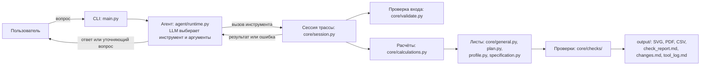

# Архитектура и роль LLM

Программа — консольный диалог. `main.py` читает входной JSON трассы, создаёт сессию `RouteSession` (`core/session.py`), проверяет наличие ключа и делает начальный выпуск в `output/`. Затем вопросы пользователя передаются агенту `RouteAgent` (`agent/runtime.py`).

Модель — `deepseek-flash` через OpenAI-совместимый API DeepSeek (`agent/settings.py`: `MODEL`, `BASE_URL`). Ключ берётся из переменной окружения `DEEPSEEK_API_KEY` или из файла `api_keys.env`.

Роль LLM ограничена:
- разбирает запрос на естественном языке;
- выбирает один из 12 инструментов (`agent/tools.py`) и заполняет его аргументы;
- задаёт уточняющий вопрос, если инструмент вернул ошибку или данных не хватает;
- пересказывает пользователю результат, предупреждения и допущения.

LLM ничего не считает и не рисует. Длины, пикетаж, отметки, количества, чертежи и проверки выполняет код:
- расчёты — `core/calculations.py`;
- проверка входных данных — `core/validate.py`;
- листы — `core/general.py`, `core/plan.py`, `core/profile.py`, `core/specification.py`;
- проверки готовых файлов — `core/checks/`;
- выпуск — `core/release.py`.

Комплект собирается во временной папке, проверяется и только потом публикуется в `output/`. Ответ агента частично проверяется кодом. Ссылка «Источник: инструмент (вопрос N)» сверяется с журналом вызовов. Слова о выпуске комплекта сверяются с успешным выпуском в текущем вопросе. При расхождении печатается предупреждение. Все вызовы пишутся в `output/tool_log.md`.

Правки из диалога живут в памяти сессии: `input/input.json` не перезаписывается, после перезапуска используются исходные данные.

## Время и стоимость

Таблица заполняется из `output/tool_log.md` финального прогона.

| Запрос | Время, с | Токены | Стоимость |
|---|---|---|---|
| | | | |
