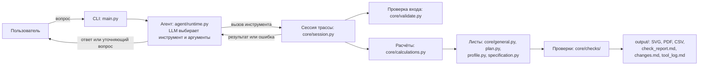

# Архитектура и роль LLM

Программа - консольный диалог. `main.py` читает входной JSON трассы, создаёт сессию `RouteSession` (`core/session.py`), проверяет наличие ключа и делает начальный выпуск в `output/`. Затем вопросы пользователя передаются агенту `RouteAgent` (`agent/runtime.py`).

Подходит любая модель с OpenAI-совместимым API. Ключ, адрес и модель задаются переменными
`LLM_API_KEY`, `LLM_BASE_URL` и `LLM_MODEL` в окружении или в `api_keys.env`.
По умолчанию используется `deepseek-flash` от DeepSeek, с ней и сделан сданный комплект.
Стоимость считается только для неё, для других моделей журнал показывает время и токены.

Роль LLM:
- разбирает запрос на естественном языке
- выбирает один из 12 инструментов (`agent/tools.py`) и заполняет его аргументы
- задаёт уточняющий вопрос, если инструмент вернул ошибку или данных не хватает
- пересказывает пользователю результат, предупреждения и допущения.

LLM ничего не считает и не рисует. 
Длины, пикетаж, отметки, количества, чертежи и проверки выполняет код:
- расчёты — `core/calculations.py`
- проверка входных данных — `core/validate.py`
- листы — `core/general.py`, `core/plan.py`, `core/profile.py`, `core/specification.py`
- проверки готовых файлов — `core/checks/`
- выпуск — `core/release.py`.

Комплект собирается во временной папке, проверяется и только потом публикуется в `output/`. 
Ответ агента частично проверяется кодом. 
Ссылка «Источник: инструмент (вопрос N)» сверяется с журналом вызовов. 
Слова о выпуске комплекта сверяются с успешным выпуском в текущем вопросе. 
При расхождении печатается предупреждение. Все вызовы пишутся в `output/tool_log.md`.

Правки из диалога живут в памяти сессии: `input/input.json` не перезаписывается, 
после перезапуска используются исходные данные.

## Время и стоимость

По `output/tool_log.md` финального прогона 10.11.2026, модель `deepseek-flash`, тариф вне пика.
Время — от вопроса до ответа агента, включая расчёт и выпуск комплекта.

| Запрос | Время, с | Токены вход (кэш) / выход | Стоимость, $ |
|---|---|---|---|
| Выпусти комплект документов по трассе input/input.json | 3,84 | 7619 (6016) / 187 | 0,000371 |
| Перемести конечную точку P5 на X = 300 м и обнови комплект | 3,56 | 9718 (9216) / 136 | 0,000185 |
| Итого за сеанс | 7,40 | 17337 (15232) / 323 | 0,000555 |

Один выпуск занимает около 4 с и стоит менее $0,001.
